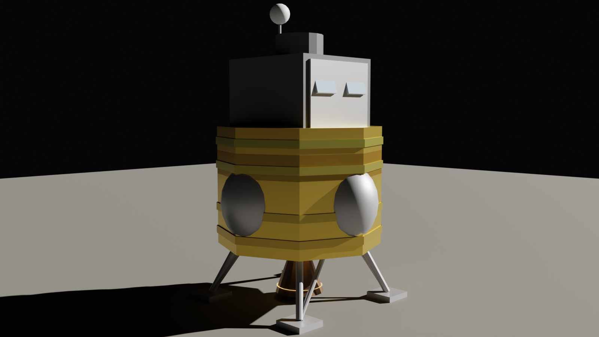
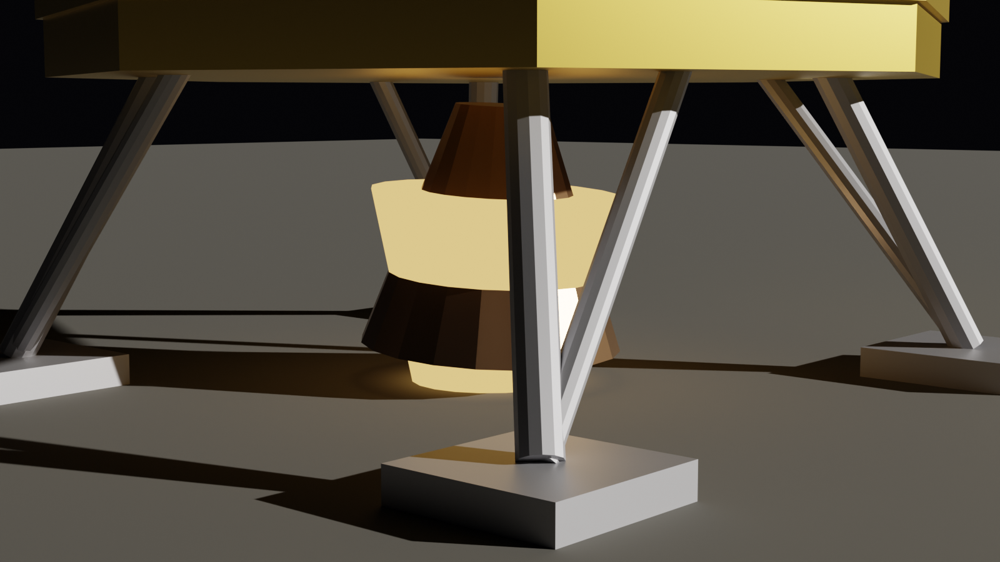
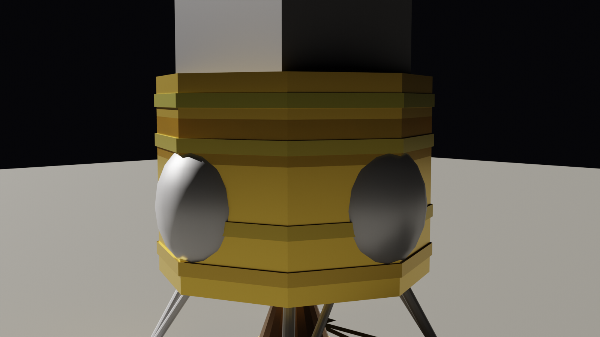
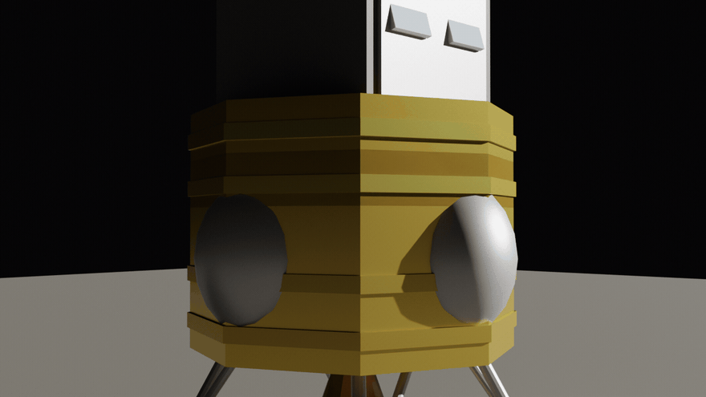

# 🛬 lander-cinema

**EN:** A lunar module that **lands** — a bang-bang suicide-burn controller integrated at 5 ms steps: ignition at t = 9.4 s (within 15% of the analytic estimate), touchdown at **1.00 m/s vertical + 0.39 m/s lateral**, with **96% of the propellant still in the tanks** at the pad. Retrograde tilt kills lateral speed; the engine never throttles below 10% — it just cannot shut off. In Blender: octagonal gold-foil descent stage, throttleable gimbaled engine, four-legged gear, RCS jets, ascent cabin.

**TR:** **İnen** Ay modülü — 5 ms adımla bang-bang suicide burn rehberi: ateşleme t = 9.4 s (analitik kestirimin %15'inde), temas **1.00 m/s dikey + 0.39 m/s yatay**, iniş anında **yakıtın %96'sı hâlâ depoda**. Retrograd eğim yatay hızı söndürür; motor %10'un altına hiç inmez — sadece kapanamaz. Blender'da: sekizgen altın folyo iniş kademesi, kısılan gimbal motor, dört ayaklı iniş takımı, RCS jetleri, üst kademe kabini.



## 🖼️ Gallery / Galeri

### 🛰️ Stüdyo — tam araç

Gold octagonal descent stage, side propellant tanks, four-leg pad, ascent cabin above. — *Altın folyo sekizgen iniş kademesi, yan yakıt tankları, dört ayak, üstte kabin.*

### 🔥 Motor detay

Throttleable bell at 55%, plume glow pooling on the regolith. — *%55 gazda kısılan çan, alev ışığı regolite havuzlanıyor.*

### ✨ Folyo detay

Thermal blankets, tank spheres, strut anchors. — *Isı yalıtım örtüleri, tank küreleri, strut ankrajları.*

### ⚙️ RCS görevi

*36 frames: attitude jets pulse, gimbal sweeps, plume flickers.*

## 🧱 Physics / Fizik

| Piece | Detail |
|---|---|
| 🔥 Throttle | 10–60% of 35 kN; mdot = F/vₑ; engine cannot shut off |
| 🪂 Start | h₀ = 500 m, v₀ = −25 m/s, lateral 15 m/s, g_ay = 1.62 |
| 📐 Guidance | bang-bang: v > √(v_t² + 2·a_net·0.85·h) → full throttle |
| 🔁 Retrograde | tilt = u/(4v) capped at 25°, thrust brakes lateral |
| ⏱️ Burn | ignites t = 9.4 s, analytic estimate 7.9 s |

## ✅ Verification / Doğrulama

```bash
python3 tests/verify.py
```

- **Touchdown gate**: |v_z| = 1.00 < 2 m/s
- **Lateral gate**: |u| = 0.39 < 0.5 m/s
- **Fuel-margin gate**: > 8% propellant remaining (actual 96%)
- **Burn-time gate**: ignition within 25% of the analytic suicide-burn solution
- **No-bounce gate**: altitude profile never rises after touchdown
- **Determinism gate**

## 🚀 Usage / Kullanım

```bash
blender --background --python lander_render.py -- --scene scenes/studyo.json
HIZLI=1 blender --background --python lander_render.py -- --scene scenes/motor_detay.json
blender --background --python lander_render.py -- --scene scenes/rcs_gorevi.json --gif 36 --fps 12
```

**Kardeş projeler:** [`terrain-cinema`](https://github.com/efealtiparmakoglu/terrain-cinema) bu aracın indiği yüzeyi, [`touchdown-cinema`](https://github.com/efealtiparmakoglu/touchdown-cinema) ikisini birleştirip son saniyeleri oynatır.

## 🧪 Why / Neden

**TR:** Fırlatma artı; bu sefer makine *durmak* zorunda ve parasüt yok. Ateşleme anı hem çok erken (yakıt biter, uçak yükselmeye devam eder) hem çok geç (çakılır) — Apollo'nun gerçek görevi tam olarak bu marjı korumaktı. Bu repo marjı denklemden hesaplar: 1 m/s'de iniyorsun, yüzde 96 yakıtla. Fizik burada estetik bir tercih değil, hayatta kalma kuralıdır.

## 📄 License

MIT
